# KB Ingestion Refactor Plan — Fix Validation Failures

## Problem Statement

Tender `003_2026_SRMCS_SOCREGMULCASSETSA` failed validation with **34 SHACL violations** and was NOT ingested into the knowledge base. The root causes are architectural: `kb_ingestion_container` tries to create and validate a **complete** tender graph, when it should only inject **enrichment data** (documents, chunks, articles) into an already-existing tender node.

---

## Root Cause Analysis

### Failure 1: SHACL Validation — 34 violations

| Violation | Root Cause | Fix Location |
|---|---|---|
| Deadline datatype mismatch: `"2026-02-11"` instead of `xsd:dateTime` | [`json_to_rdf.py:96`](kb_ingestion_container/src/json_to_rdf.py:96) declares `xsd:dateTime` but `parse_date()` returns `date` object, producing `"2026-02-11"` instead of `"2026-02-11T00:00:00"` | `json_to_rdf.py` |
| Missing `Has_Category` | Avis metadata lacks category. SHACL TendersShape requires `minCount 1`. Category should already exist from migration. | `json_to_rdf.py` + `shapes.ttl` |
| Missing `Launched_by` | Avis metadata `contact` field is empty. SHACL requires exactly 1 Buyer. Buyer should already exist from migration. | `json_to_rdf.py` + `shapes.ttl` |
| Missing `Is_Bordereau_of` articles | SHACL validates enrichment graph in isolation — articles are present but the full Tenders shape fires because `map_avis()` declares `(tender_uri, rdf:type, ts:Tenders)` | `json_to_rdf.py` |

### Failure 2: Logical Consistency Check

- [`data_tester.py:200-203`](kb_ingestion_container/src/data_tester.py:200): Asserts every `ts:Tenders` instance must have `Launched_by`. The enrichment graph re-declares the tender type but doesn't include Buyer — assertion fails.

### Failure 3: Ingestion Aborted

- [`main.py:97-100`](kb_ingestion_container/main.py:97): `test_tender_graph()` returns `False`, triggering abort and DLQ move.

### Architectural Root Cause

`kb_ingestion_container` has **role confusion**: it re-creates tender core metadata (type, buyer, category, region) that should already exist from `migration_container` / `Update_script`. The SHACL validation then fires on this incomplete re-creation.

---

## Solution Architecture

### Approach: Enrichment-Only Graph

Stop re-creating the tender node and its core connections. The enrichment graph should **only** contain:
- Supplemental data properties on the existing tender IRI (modes, caution, durations, multilot flag)
- Bordereau + Articles subgraph
- Specification parent + chunk nodes
- Administrative parent + chunk nodes
- Lot nodes for multi-lot tenders

By **not** adding `(tender_uri, rdf:type, ts:Tenders)`, the SHACL `TendersShape` won't fire on the enrichment graph. The Bordereau/Article/Specification/Reglement shapes will still validate correctly.

```mermaid
flowchart TD
    subgraph migration_container
        A[SQL DB] --> B[TripleBuilder]
        B --> C[Tender Node + Buyer + Category + Region + Deadline]
        C --> D[Jena KB - INSERT DATA]
    end

    subgraph kb_ingestion_container - CURRENT
        E[S3 Chunks JSON] --> F[JsonToRdfMapper]
        F --> G[FULL Tender re-creation + Enrichment]
        G --> H[SHACL Full TendersShape]
        H -->|FAILS - missing Buyer/Category| I[Abort Ingestion]
    end

    subgraph kb_ingestion_container - PROPOSED
        J[S3 Chunks JSON] --> K[JsonToRdfMapper - Enrichment Only]
        K --> L[Supplemental props + Bordereau + Spec + Admin]
        L --> M[SHACL Enrichment Shapes Only]
        M -->|PASSES| N[Jena KB - INSERT DATA]
        N --> O[Post-ingestion Quality Gates via SPARQL ASK]
    end

    style I fill:#f44,color:#fff
    style N fill:#4CAF50,color:#fff
```



---

## Implementation Plan by Container

---

## Container 1: `kb_ingestion_container` — PRIMARY REFACTOR

### 1.1 Refactor `src/json_to_rdf.py`

**Goal**: Make `map_avis()` enrichment-only — no tender type, no buyer, no category, no region.

**Changes in [`map_avis()`](kb_ingestion_container/src/json_to_rdf.py:56):**

- **Remove** line 58: `self.graph.add((self.tender_uri, RDF.type, TS.Tenders))`
- **Remove** buyer creation block (lines 129-134): The `if metadata.contact:` block that creates Buyer node and `Launched_by` link
- **Remove** category creation block (lines 70-73): The `if metadata.category:` block
- **Remove** region/location block (lines 136-139): The `if metadata.location:` block  
- **Keep** all supplemental data properties:
  - `Has_Object` — add conditionally to enrich if not already in KB
  - `Has_Mode_Soumission`, `Has_Mode_Passation`
  - `Has_Budget`, `Has_Caution`
  - `Has_Multilot` flag
  - `Has_Qualifications`
  - Duration calculations (`durationLaunchToDeadlineDays`, etc.)
- **Fix** date datatype bug at lines 93-96: Change `Has_Deadline` from `xsd:dateTime` to `xsd:date`, or produce proper datetime values. Since `parse_date()` returns `date` objects and the SHACL shape expects `xsd:dateTime`, the cleanest fix is to use `xsd:date` for all date properties that come from `parse_date()`. BUT — the migration_container already uses `xsd:dateTime` for `Has_Deadline`. So the enrichment should NOT re-set `Has_Deadline` at all since it already exists from migration.
- **Remove** date properties that already exist from migration: `Has_Deadline`, `hasLaunchDate` — these are core tender data from the SQL DB
- **Keep** date properties unique to avis extraction: `hasAdjudicationDate`, `hasExecutionStartDate` — use `xsd:date` datatype consistently

**Changes in [`map_products()`](kb_ingestion_container/src/json_to_rdf.py:196):**
- No changes needed — this correctly creates Bordereau + Articles and links to tender_uri

**Changes in `map_specification()` and `map_administrative()`:**
- No changes needed — these correctly create spec/admin parent + chunk nodes

### 1.2 Create `ontology/shapes_enrichment.ttl`

**Goal**: Enrichment-specific SHACL shapes that validate ONLY what the enrichment graph produces.

**Contents:**
- `BordereauxShape` — same as current, validates articles exist
- `ArticlesShape` — same as current, validates designation
- `TenderSpecificationsChunkShape` — validates chunk nodes have `Has_Chunk_Identifier`
- `TenderReglementChunkShape` — validates admin chunk nodes have `Has_Chunk_Identifier`
- **No** `TendersShape` — tender core validation belongs in migration

### 1.3 Refactor `src/data_tester.py`

**Goal**: Align validation with enrichment-only scope.

**Changes in [`test_tender_graph()`](kb_ingestion_container/src/data_tester.py:38):**
- Load `shapes_enrichment.ttl` instead of `shapes.ttl`
- This ensures SHACL only validates enrichment entities

**Changes in [`_assert_logical_consistency()`](kb_ingestion_container/src/data_tester.py:185):**
- **Remove** the buyer check (lines 200-204): `buyer = g.value(tender, TS.Launched_by)` assertion
- **Remove** the `Has_Object` check (lines 194-198): The enrichment graph may not include this
- **Remove** the budget check (lines 188-192): Enrichment might not have budget  
- **Remove** the entire `for tender in g.subjects(RDF.type, TS.Tenders):` loop — the enrichment graph won't have any `ts:Tenders` typed nodes
- **Keep** chunk identifier warnings (lines 206-215)
- **Keep** article quantity checks (lines 217-221)
- **Add** new enrichment-specific assertions:
  - Every Bordereau must have at least 1 Article
  - Every spec/admin chunk must have `Has_Chunk_Identifier`

**Changes in [`validate_tender_in_jena()`](kb_ingestion_container/src/data_tester.py:159):**
- No changes — post-ingestion quality gates that check Jena are correct

### 1.4 Update `src/config.py`

**Add** new setting:
```python
ENRICHMENT_SHAPES_FILE: str = "shapes_enrichment.ttl"
```

### 1.5 Update `main.py`

**Changes in [`__init__()`](kb_ingestion_container/main.py:35):**
- Pass enrichment shapes file path to `DataTester`:
```python
self.tester = DataTester(
    ontology_path=os.path.join(settings.ONTOLOGY_DIR, settings.TENDER_STRUCTURE_FILE),
    shapes_path=os.path.join(settings.ONTOLOGY_DIR, settings.ENRICHMENT_SHAPES_FILE),
    jena_client=self.jena,
)
```

**Changes in [`process_message()`](kb_ingestion_container/main.py:47):**
- Remove the `map_avis` step for core tender properties — or keep it but with the refactored enrichment-only `map_avis()`
- The flow stays the same: build enrichment graph → validate → insert → post-validate

### 1.6 Update Tests

**[`tests/test_json_to_rdf.py`](kb_ingestion_container/tests/test_json_to_rdf.py):**
- Update avis mapping tests to verify NO `rdf:type ts:Tenders` triple is created
- Update to verify NO `Launched_by`, `Has_Category`, `Is_Located_In` triples
- Add tests for supplemental properties only

**[`tests/test_data_tester.py`](kb_ingestion_container/tests/test_data_tester.py):**
- Update to use enrichment shapes
- Remove tests that check buyer/category assertions
- Add enrichment-specific assertion tests

---

